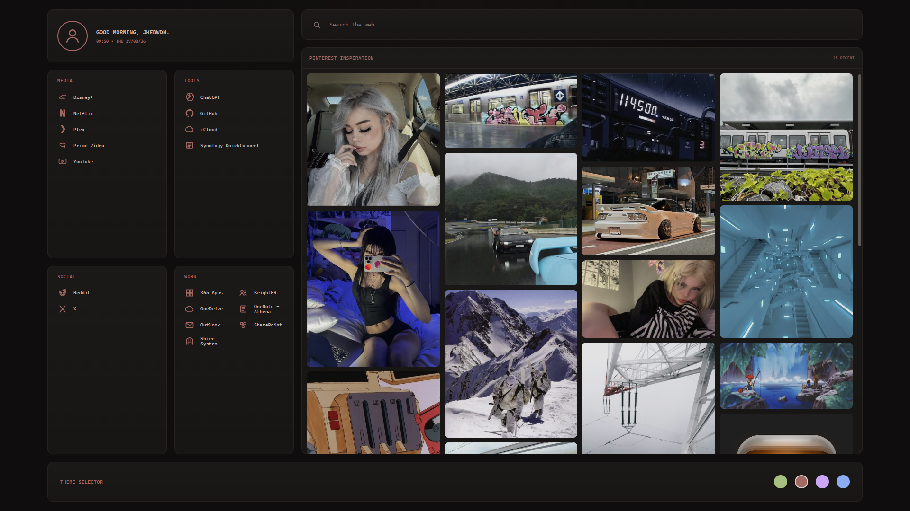
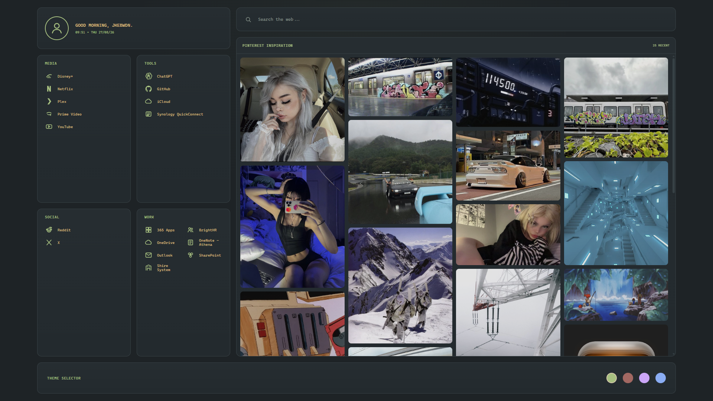
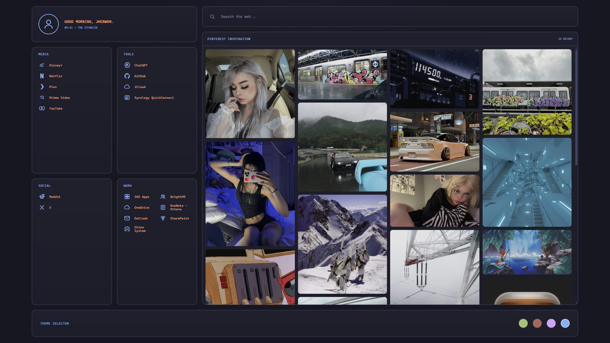

# Startpage

A custom browser start page built with vanilla HTML, CSS and JavaScript.

Designed to match my desktop themes across Windows, Linux and macOS, with quick links, theme switching and a live Pinterest inspiration feed.



## Features

- Responsive custom dashboard
- Dynamic greeting, time and date
- Search bar
- Categorised quick links
  - Media
  - Tools
  - Social
  - Work
- Four selectable themes
  - Everforest
  - BlackMetalKhold / Komorebi
  - Catppuccin
  - Arch / Zen
- Theme preference saved with `localStorage`
- Periodically refreshed Pinterest masonry feed with last-known-good fallback
- Public Pinterest RSS normalized by GitHub Actions; no browser proxy or API token
- Responsive masonry layout
- Hosted with GitHub Pages

## Pinterest Feed

The panel reads same-origin `feed/pinterest.json`. A scheduled GitHub Action fetches
`https://uk.pinterest.com/jkebwdn/feed.rss` once every six hours (00:23, 06:23, 12:23,
18:23 UTC), validates RSS and image/link URLs, and atomically updates up to 40 Pins.
GitHub schedules can be delayed. This unofficial public RSS feed is not guaranteed
by Pinterest; no private API, credentials, scraping or anti-bot bypass is used.

```text
Public Pinterest RSS → GitHub Actions → feed/pinterest.json → static masonry grid
```

### Deployment and refresh

Keep **Settings → Pages → Deploy from a branch → main / (root)**. The workflow
`.github/workflows/pinterest-feed.yml` verifies that source, commits only valid feed
JSON, then explicitly requests a Pages build. This is necessary because commits made
with `GITHUB_TOKEN` do not automatically trigger branch-based Pages builds.

No custom Secrets are required. The refresh job uses the repository's automatic
`GITHUB_TOKEN` with only `contents: write` and `pages: write`. It runs on the original
repository's main branch, never on pull requests. Repository rules must allow the
bot's feed commit. To refresh immediately, choose **Actions → Refresh Pinterest
feed → Run workflow**. Check the refresh run and subsequent Pages build for success.

A failed/blocked request, malformed XML, empty feed or invalid Pins fails the refresh
without overwriting the committed last-good JSON. There are no automatic retries.
The browser also keeps validated last-good Pin metadata in localStorage. On refresh
failure it keeps existing/cached cards; data over 24 hours old shows a quiet
“Cached pins” status with the last refresh time in its tooltip. Images still depend
on Pinterest's CDN/browser cache; metadata caching does not guarantee offline images.
Resize only rearranges existing cards and never requests another feed.

The previous Cloudflare Worker is no longer used. Its upstream RSS request returned
403 (surfaced as Worker HTTP 500), while the same public URL returned valid RSS with
25 Pins from the operator's host on 2026-10-28. Worker CORS was correct; no API-specific
`PINNER_DATA_ACCESS_DENIED` response was observed. The initial JSON was generated from
that successful public response, not fabricated content. GitHub-hosted refresh access
must be checked in the first workflow run; a host success alone does not prove it.

### Local validation

```bash
python3 -m unittest discover -s tests -p 'test_*.py'
node --test tests/pinterest.test.cjs
python3 -m http.server 8765 --bind 127.0.0.1
```

Open `http://127.0.0.1:8765/` to check cards, themes and responsive widths. Tests use
synthetic RSS/DOM/network failures and temporary files; they do not contact Pinterest.
For a deliberate one-off public refresh, run `python3 scripts/update_pinterest.py`.

## Themes

### BlackMetalKhold / Komorebi


### Everforest



### Arch / Zen



## Files

```text
startpage/
├── index.html
├── style.css
├── script.js
├── feed/pinterest.json
├── scripts/update_pinterest.py
├── tests/
├── .github/workflows/pinterest-feed.yml
└── README.md
```
